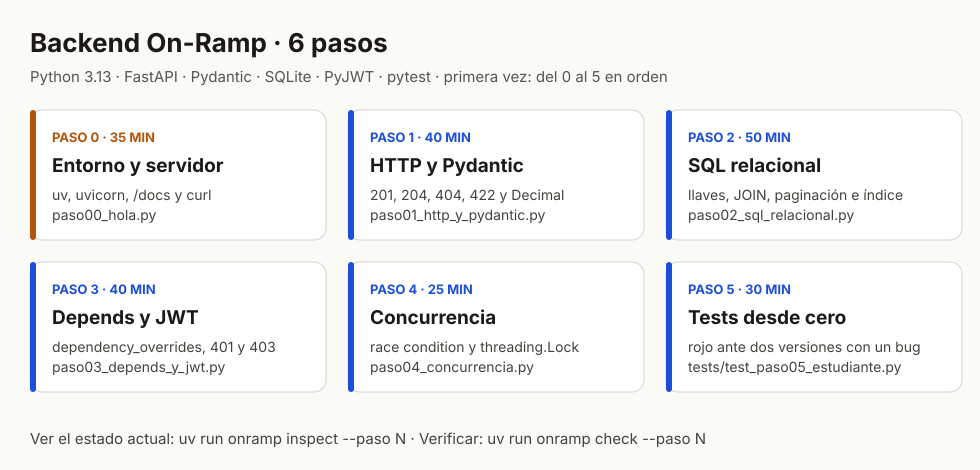

# Biblioteca — Backend Onramp (Solución de referencia)

Este repositorio contiene la solución completa y verificada de [Backend Onramp](https://github.com/ykro/backend-onramp) para el [Curso 1 de Backend con FastAPI](https://github.com/ykro/backend-course). Las 17 pruebas de [tests/test_onramp.py](tests/test_onramp.py) pasan aquí sin Docker ni cuentas externas, tanto en conjunto como por separado con `--paso 1` hasta `--paso 5`.

## Los 5 pasos (independientes)

| Paso | Enfoque | Guía |
| --- | --- | --- |
| Paso 1 | Contratos HTTP/1.1 (`201`, `204`, `404`), estado aislado y Pydantic (`extra="forbid"`, `Decimal`, `422`) | [steps/01-http-y-pydantic/README.md](steps/01-http-y-pydantic/README.md) |
| Paso 2 | SQLite relacional (`PRAGMA foreign_keys`, `INNER JOIN`, paginación e índice) | [steps/02-sql-relacional/README.md](steps/02-sql-relacional/README.md) |
| Paso 3 | `Depends`, `dependency_overrides`, JWT en Base64Url y `401` vs `403` | [steps/03-depends-y-jwt/README.md](steps/03-depends-y-jwt/README.md) |
| Paso 4 | Concurrencia y exclusión mutua con `threading.Lock` ante `Barrier(5)` | [steps/04-concurrencia/README.md](steps/04-concurrencia/README.md) |
| Paso 5 | Pruebas automatizadas desde cero con `pytest` (Arrange -> Act -> Assert) | [steps/05-pruebas-desde-cero/README.md](steps/05-pruebas-desde-cero/README.md) |

## Dónde ver la solución de cada paso

Si vienes del [repositorio del problema](https://github.com/ykro/backend-onramp), esta tabla indica qué se trabajó, qué cambio exacto resuelve cada criterio y en qué archivo está la solución.

| Paso | Criterio | Qué se cambió y por qué | Archivo de solución |
| --- | --- | --- | --- |
| Paso 1 | `CA-1.1` a `CA-1.5` | Se añadió `status_code=201` en `POST /books`, `HTTPException(404)` en `GET /books/{book_id}`, `Response(status_code=204)` sin cuerpo en `DELETE /books/{book_id}`, se movieron `books` y `next_id` dentro de `create_app()` con `nonlocal next_id`, y en `BookCreate` se agregó `ConfigDict(extra="forbid")`, `title` con `Field(min_length=1, max_length=120)` y `price: Decimal = Field(gt=Decimal("0"), decimal_places=2)`. | [paso01_http_y_pydantic.py](paso01_http_y_pydantic.py) |
| Paso 2 | `CA-2.1` a `CA-2.4` | En `init_db` se activó `PRAGMA foreign_keys = ON` y se creó `idx_books_author_id` (cambiando `SCAN books` a `SEARCH books USING INDEX`); se implementó `INNER JOIN` en `list_books_with_authors` y paginación ordenada con filtro `LIKE ?` parametrizado en `list_books_page`. | [paso02_sql_relacional.py](paso02_sql_relacional.py) |
| Paso 3 | `CA-3.1` a `CA-3.3` | En `GET /rooms` se inyectó `repo` con `Depends(get_room_repo)` para habilitar `dependency_overrides`; en `decode_jwt_payload_unverified` se decodificó `parts[1]` en Base64Url con relleno `=`; en `POST /admin/rooms` se cambió el rechazo de rol insuficiente de `401` a `403 Forbidden`. | [paso03_depends_y_jwt.py](paso03_depends_y_jwt.py) |
| Paso 4 | `CA-4.1`, `CA-4.2` | En `RoomReservationService` se agregó `self._lock = threading.Lock()` y se envolvió el cuerpo de `reserve` y `reservation_count` en `with self._lock:`, garantizando que ante 5 hilos simultáneos con `Barrier(5)` solo 1 hilo reserve la sala (`stored == 1`). | [paso04_concurrencia.py](paso04_concurrencia.py) |
| Paso 5 | `CA-5.1`, `CA-5.2` | Se escribieron 3 pruebas con Arrange -> Act -> Assert sobre `paso05_pruebas.calculate_late_fee` (caso normal de 4 días, caso borde `days_late <= 0` con `0` y `-3`, y verificación del primer día de atraso), pasando en verde con la función sana y fallando en rojo contra `calculate_late_fee_buggy`. | [tests/test_paso05_estudiante.py](tests/test_paso05_estudiante.py) |

## Inicio rápido y verificación

1. Instala las dependencias con `uv sync` (o `UV_CACHE_DIR=/tmp/uv-cache-onramp uv sync` si tu caché global tiene permisos restringidos).
2. Inspecciona todos los pasos o uno específico con `uv run onramp inspect` o `uv run onramp inspect --paso N`.
3. Verifica todas las pruebas o un paso específico con `uv run onramp check` o `uv run onramp check --paso N`.

Consulta el [glosario con documentación oficial](docs/glosario.md) , la guía corta [Cómo leer un ADR](docs/adr-ejemplo.md) y [Qué es la Integración Continua (CI)](docs/ci.md) para repasar conceptos del curso principal. Al igual que en el repositorio inicial, [AGENTS.md](AGENTS.md) mantiene el modo tutor socrático por si usas un asistente de IA para revisar la solución.

## Repositorios relacionados

- Índice general de nivelaciones: [ykro/courses-onramp](https://github.com/ykro/courses-onramp)
- Repositorio inicial con ejercicios: [ykro/backend-onramp](https://github.com/ykro/backend-onramp)
- Curso principal: [ykro/backend-course](https://github.com/ykro/backend-course)
