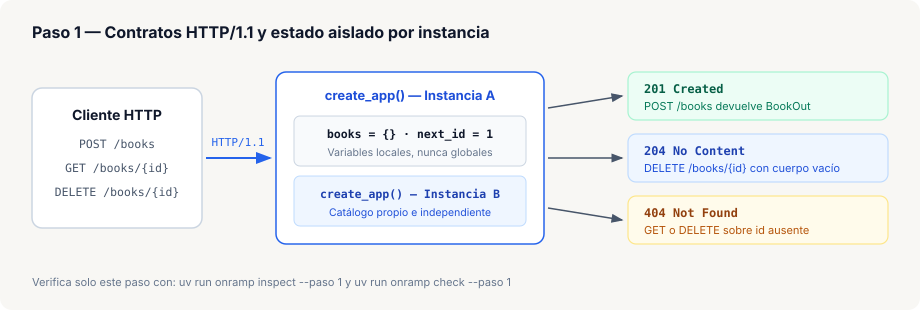

# Paso 1. Contratos HTTP/1.1 y estado aislado



## Por qué importa

Un servidor backend real nunca responde `200 OK` a todas las operaciones. Cuando devuelves códigos HTTP precisos según [MDN HTTP response status codes](https://developer.mozilla.org/en-US/docs/Web/HTTP/Status), [FastAPI Response Status Code](https://fastapi.tiangolo.com/tutorial/response-status-code/) y [FastAPI Handling Errors](https://fastapi.tiangolo.com/tutorial/handling-errors/), cualquier cliente distingue si creó un recurso (`201`), si borró sin cuerpo (`204`) o si pidió un identificador inexistente (`404`). Aislar el estado dentro de `create_app()` impide además que dos instancias de la aplicación mezclen sus datos durante las pruebas.

## Qué se construye

Trabajas sobre [paso01_http_contratos.py](../../paso01_http_contratos.py) (~12 minutos):

- **Creación con `201 Created` (TODO 1):** agrega `status_code=status.HTTP_201_CREATED` al decorador `@app.post("/books", ...)`.
- **Error `404 Not Found` en `GET /books/{book_id}` (TODO 2):** cuando el libro no existe, lanza `HTTPException(status_code=status.HTTP_404_NOT_FOUND, detail="Libro no encontrado")` en vez de devolver un diccionario con código `200`.
- **Borrado con `204 No Content` en `DELETE /books/{book_id}` (TODO 3):** agrega `status_code=status.HTTP_204_NO_CONTENT` y devuelve `Response(status_code=status.HTTP_204_NO_CONTENT)` sin cuerpo.
- **Estado aislado dentro de `create_app()` (TODO 4):** elimina `_SHARED_BOOKS` y `_NEXT_ID` del nivel de módulo y decláralos como variables locales (`books` y `next_id`) dentro de `create_app()`, usando `nonlocal next_id` en `create_book`.

## Criterios de aceptación

- `CA-1.1` `POST /books` responde `201 Created`, `GET /books/1` responde `200 OK` y `GET /books/999` responde `404 Not Found`.
- `CA-1.2` `DELETE /books/{book_id}` responde `204 No Content` con cuerpo vacío (`b""`), y un segundo borrado del mismo identificador responde `404 Not Found`.
- `CA-1.3` Dos instancias creadas con `create_app()` mantienen catálogos separados: crear un libro en una instancia deja vacía la lista `GET /books` de la otra.

## Cómo verificar

Observa primero las respuestas HTTP crudas del Paso 1 y luego corre sus pruebas:

```bash
uv run onramp inspect --paso 1
uv run onramp check --paso 1
```
