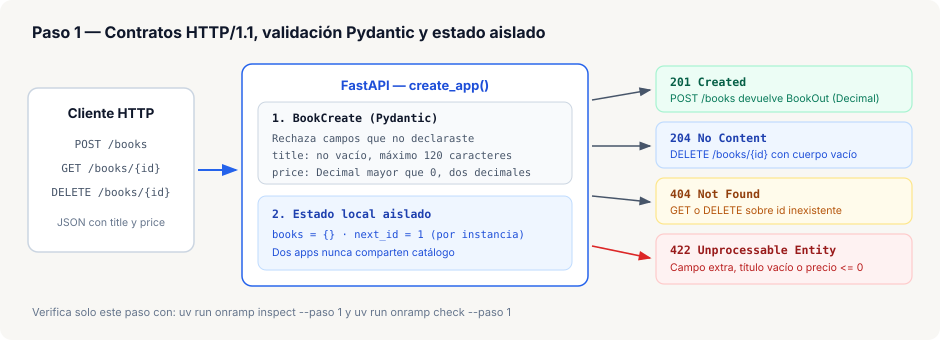

# Paso 1. Códigos HTTP, estado aislado y validación con Pydantic



Este paso toma unos 40 minutos.

## Antes de empezar

1. Si un cliente crea un libro y el servidor responde `200`, ¿cómo sabe el cliente si se creó algo nuevo o solo se leyó algo que ya existía?
2. ¿Por qué guardar precios en `float` puede cobrar mal un centavo? Prueba `0.1 + 0.2` en Python.
3. Si dos tests crean su propia app con `create_app()`, ¿deberían ver los mismos libros?

## Por qué importa

Un backend real no responde `200 OK` a todo ni confía en el JSON que le mandan. Los [códigos de estado](https://developer.mozilla.org/en-US/docs/Web/HTTP/Status) le dicen al cliente qué pasó (`201` creado, `204` borrado sin cuerpo, `404` no existe, `422` datos inválidos), y [Pydantic](https://docs.pydantic.dev/latest/concepts/models/) revisa cada request antes de que llegue a tu función. Es exactamente lo que harás en la Unidad 1 del curso con SplitMate.

## Lo mínimo que necesitas saber

- **`nonlocal`.** Una función definida dentro de otra puede leer sus variables, pero para reasignar una, como un contador, necesita declararla `nonlocal`.
- **`model_config` y `Field`.** En un modelo de Pydantic, `model_config = ConfigDict(...)` controla qué hace con campos desconocidos, y `Field` define límites como longitud mínima o "mayor que".
- **`Decimal`.** Guarda montos exactos en base 10, a diferencia de `float`. Pydantic sabe validar cuántos decimales trae.

## Qué vas a hacer

- **Leer.** Corre `uv run onramp inspect --paso 1` y anota qué código devuelve hoy cada request. Luego abre [paso01_http_y_pydantic.py](../../paso01_http_y_pydantic.py) y ubica los seis `TODO`.
- **Debuguear.** Cada `TODO` describe un comportamiento incorrecto que viste en `inspect`. Antes de tocar código, predice qué código de estado debería salir en cada caso y compáralo con la tabla de [MDN](https://developer.mozilla.org/en-US/docs/Web/HTTP/Status).
- **Escribir.** Corrige los seis comportamientos. Puedes levantar el servidor con `uv run uvicorn paso01_http_y_pydantic:create_app --factory --reload` y probar en `/docs` mientras trabajas.

## Criterios de aceptación

- `CA-1.1` `POST /books` responde `201`, `GET /books/1` responde `200` y `GET /books/999` responde `404`.
- `CA-1.2` `DELETE /books/{book_id}` responde `204` con cuerpo vacío, y un segundo borrado del mismo libro responde `404`.
- `CA-1.3` Dos apps creadas con `create_app()` mantienen catálogos separados.
- `CA-1.4` `POST /books` responde `422` con un campo extra, título vacío, precio negativo, precio cero o más de dos decimales.
- `CA-1.5` `BookCreate.price` es `Decimal` y conserva el monto exacto.

## Al terminar

1. Un cliente manda `{"title": "Popol Vuh", "price": "99.999"}`. ¿Qué responde tu API y qué parte de tu código lo decide?
2. Si el frontend borra un libro y tu API responde `204`, ¿por qué no tiene sentido que el frontend intente leer el cuerpo de la respuesta?
3. Imagina que `_SHARED_BOOKS` se hubiera quedado global y que el curso corre 40 tests en orden. ¿Qué tipo de fallos aparecerían y por qué serían difíciles de reproducir?
4. Explica en tres líneas, con tus palabras, qué cambiaste y por qué. Si no puedes, vuelve a la pista 1 antes de seguir.

## Cómo verificar

```bash
uv run onramp inspect --paso 1
uv run onramp check --paso 1
```

Si te trabas, abre la [pista 1](hints/1.md). Cada pista da un poco más que la anterior; la pista 3 trae un esqueleto, nunca la respuesta completa.

## Respuestas de autoevaluación

1. Responde `422`, porque `price` declara `decimal_places=2` en `BookCreate`. Pydantic rechaza el JSON antes de que se ejecute `create_book`.
2. Porque `204 No Content` significa que la respuesta no trae cuerpo por diseño. El cliente solo necesita el código para saber que el borrado funcionó.
3. Tests que pasan solos y fallan en grupo, o que cambian según el orden, porque cada test vería libros creados por los anteriores. Son difíciles de reproducir porque el fallo depende de la historia y no del test que falla.
4. Respuesta personal. Debe mencionar los códigos `201`, `204` y `404`, el estado movido dentro de `create_app()` y la validación con `Decimal` y `extra="forbid"`.
