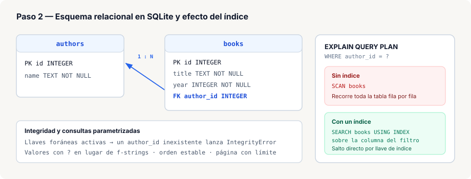

# Paso 2. Tu primera base de datos relacional con SQLite



Este paso toma unos 60 minutos.

## Antes de empezar

1. Si guardas libros y autores en dos listas de Python, ¿qué impide que un libro apunte a un autor que no existe?
2. En Estructuras de datos viste búsqueda lineal y búsqueda en árboles. ¿Cuál esperas que use una base de datos para encontrar los libros de un autor entre un millón?
3. ¿Qué podría pasar si armas una consulta SQL pegando el texto que escribió el usuario?

## Por qué importa

En la Unidad 2 del curso trabajarás con SQLModel, un ORM (una librería que convierte clases de Python en tablas y genera el SQL por ti), sobre una base de datos real. Antes de usarlo conviene ver qué hace la base de datos por debajo, con [sqlite3](https://docs.python.org/3/library/sqlite3.html), que ya viene con Python y no necesita instalar nada.

## Lo mínimo que necesitas saber

- **Tabla, fila y columna.** Una tabla es como una lista de registros con la misma forma. Cada fila es un registro y cada columna un campo con tipo (`INTEGER`, `TEXT`).
- **Llave primaria (`PRIMARY KEY`).** Identifica cada fila de forma única, como el `id` de un libro.
- **Llave foránea (`FOREIGN KEY`).** Una columna que apunta a la llave primaria de otra tabla, como `books.author_id` hacia `authors.id`. La base de datos puede impedir que apunte a algo que no existe.
- **Consulta.** `SELECT columnas FROM tabla WHERE condición ORDER BY columna` lee filas. `JOIN` combina filas de dos tablas que coinciden en una columna. `LIMIT n OFFSET m` salta `m` filas y devuelve `n`, y `LIKE ?` con `%texto%` busca títulos que lo contienen.
- **Índice.** Una estructura aparte, parecida a un árbol B, que permite encontrar filas sin recorrer toda la tabla.
- **El problema N+1.** Si primero pides la lista de libros y después, por cada libro, una consulta para su autor, haces 1 + N consultas. Con mil libros son 1,001 viajes a la base de datos, y la página se vuelve lenta aunque cada consulta sea rápida. Un `JOIN` trae libros y autores en una sola consulta. El test de `CA-2.2` cuenta las consultas y falla si aparece este patrón.

Puedes probar todo esto en vivo con `uv run python` y `import sqlite3; conn = sqlite3.connect(":memory:")`.

## Qué vas a hacer

- **Leer.** Lee las dos tablas que crea `init_db` en [paso02_sql_relacional.py](../../paso02_sql_relacional.py) y corre `uv run onramp inspect --paso 2`. Fíjate en el libro huérfano que SQLite deja guardar y en la palabra `SCAN` del plan de la consulta.
- **Debuguear.** Explica con tus palabras por qué SQLite aceptó un `author_id` que no existe, aunque la tabla declara `FOREIGN KEY`. La respuesta está en la [documentación de llaves foráneas](https://www.sqlite.org/foreignkeys.html#fk_enable).
- **Escribir.** Completa los cuatro `TODO`, dos en `init_db` y dos consultas. Las consultas devuelven listas de diccionarios con las llaves que pide cada docstring.

## Criterios de aceptación

- `CA-2.1` `init_db` activa las llaves foráneas y SQLite lanza `sqlite3.IntegrityError` al insertar un libro con un autor inexistente.
- `CA-2.2` `list_books_with_authors` devuelve cada libro con `id`, `title`, `year` y `author_name`, ordenado por id, con una sola consulta `SELECT`.
- `CA-2.3` `list_books_page` pagina ordenado por título, usa parámetros `?` y trata un texto malicioso como texto literal sin alterar la tabla.
- `CA-2.4` `explain_books_by_author` reporta `SEARCH` y `USING INDEX`, sin `SCAN books`.

## Al terminar

1. Borras un autor que todavía tiene libros. Con las llaves foráneas activas, ¿qué pasa y por qué es mejor que la base de datos lo impida en lugar de tu código Python?
2. La página 3 de 10 libros por página, ¿qué `LIMIT` y qué `OFFSET` usa? ¿Qué problema aparece si no ordenas antes de paginar?
3. Un índice acelera las búsquedas por `author_id`. ¿Qué operación se vuelve un poco más lenta a cambio y por qué?
4. Explica en tres líneas, con tus palabras, qué cambiaste y por qué. Si no puedes, vuelve a la pista 1 antes de seguir.

## Cómo verificar

```bash
uv run onramp inspect --paso 2
uv run onramp check --paso 2
```

Si te trabas, abre la [pista 1](hints/1.md). Cada pista da un poco más que la anterior; la pista 3 trae un esqueleto, nunca la respuesta completa.

## Respuestas de autoevaluación

1. SQLite rechaza el borrado con `IntegrityError` mientras existan libros que apuntan a ese autor. La base de datos lo garantiza para cualquier programa que la use, mientras que una validación en Python solo protege al código que se acuerda de llamarla.
2. `LIMIT 10 OFFSET 20`. Sin `ORDER BY`, la base de datos puede devolver las filas en cualquier orden, así que un libro podría aparecer en dos páginas o en ninguna.
3. Insertar, actualizar o borrar filas, porque la base de datos también tiene que actualizar el índice. Por eso no se indexa cada columna, solo las que se usan para buscar.
4. Respuesta personal. Debe mencionar el `PRAGMA`, el `JOIN` entre las dos tablas, los parámetros `?` y el índice que cambia `SCAN` por `SEARCH`.
