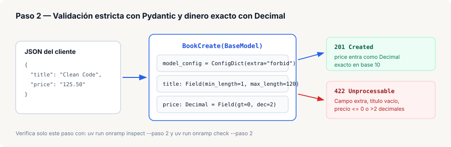

# Paso 2. Validación estricta con Pydantic y `Decimal`



## Por qué importa

Los datos que llegan por HTTP siempre vienen de afuera de tu sistema. Si aceptas campos desconocidos, títulos vacíos o precios en `float`, los errores entran en silencio y dañan tus cálculos de dinero. Definir esquemas estrictos con [Pydantic `ConfigDict`](https://docs.pydantic.dev/latest/api/config/), [Pydantic `Field`](https://docs.pydantic.dev/latest/concepts/fields/) y [`Decimal`](https://docs.python.org/3/library/decimal.html) garantiza que FastAPI rechace entradas inválidas con `422 Unprocessable Entity` antes de tocar tu lógica de negocio.

## Qué se construye

Trabajas sobre [paso02_validacion_pydantic.py](../../paso02_validacion_pydantic.py) (~10 minutos):

- **Rechazar campos extra en `BookCreate` (TODO 1):** agrega `model_config = ConfigDict(extra="forbid")`.
- **Restringir `title` (TODO 2):** define `title: str = Field(min_length=1, max_length=120)` para impedir títulos vacíos o desmedidos.
- **Usar `Decimal` para `price` (TODO 3):** cambia `price` de `float` a `Decimal = Field(gt=Decimal("0"), decimal_places=2)` y guarda `payload.price` directo en `BookOut`.

## Criterios de aceptación

- `CA-2.1` `POST /books` responde `422 Unprocessable Entity` cuando el JSON incluye un campo no declarado en `BookCreate`.
- `CA-2.2` `POST /books` responde `422 Unprocessable Entity` ante título vacío, precio negativo, precio cero o más de dos decimales.
- `CA-2.3` `BookCreate.price` usa el tipo `Decimal` y conserva el monto exacto en base 10 al crear el libro (`201 Created`).

## Cómo verificar

Observa qué acepta hoy `BookCreate` y luego corre las pruebas del Paso 2:

```bash
uv run onramp inspect --paso 2
uv run onramp check --paso 2
```
