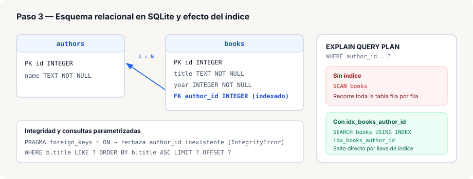

# Paso 3. SQLite relacional, JOIN, paginación e índices



## Por qué importa

Antes de usar un ORM en el curso principal, necesitas ver cómo responde una base de datos relacional real en [`sqlite3`](https://docs.python.org/3/library/sqlite3.html). Activar [`PRAGMA foreign_keys`](https://www.sqlite.org/foreignkeys.html) impide filas huérfanas, combinar tablas con [`INNER JOIN`](https://www.sqlite.org/lang_select.html#fromclause) y paginar con [`ORDER BY` / `LIMIT` / `OFFSET`](https://www.sqlite.org/lang_select.html#limitoffset) usando parámetros `?` protege tus consultas contra inyección SQL, y revisar [`EXPLAIN QUERY PLAN`](https://www.sqlite.org/eqp.html) te muestra la diferencia concreta entre recorrer toda la tabla (`SCAN`) y buscar con un índice (`SEARCH USING INDEX`).

## Qué se construye

Trabajas sobre [paso03_sql_relacional.py](../../paso03_sql_relacional.py) (~18 minutos):

- **Llaves foráneas activas en `init_db` (TODO 1):** ejecuta `conn.execute("PRAGMA foreign_keys = ON")` antes de crear las tablas `authors` y `books`.
- **Consulta con `INNER JOIN` en `list_books_with_authors` (TODO 2):** une `books AS b` con `authors AS a ON a.id = b.author_id`, ordena con `ORDER BY b.id ASC` y devuelve diccionarios con las llaves `id`, `title`, `year` y `author_name`.
- **Paginación y filtro seguro en `list_books_page` (TODO 3):** usa `INNER JOIN`, `ORDER BY b.title ASC LIMIT ? OFFSET ?` y, cuando `title_filter` no es `None`, agrega `WHERE b.title LIKE ?` pasando `f"%{title_filter}%"` en la tupla de parámetros de `conn.execute(...)`.
- **Índice en `init_db` (TODO 4):** crea `CREATE INDEX IF NOT EXISTS idx_books_author_id ON books(author_id)` para eliminar `SCAN books`.

## Criterios de aceptación

- `CA-3.1` `init_db(conn)` activa `PRAGMA foreign_keys = ON` y SQLite lanza `sqlite3.IntegrityError` al insertar un libro con un `author_id` inexistente.
- `CA-3.2` `list_books_with_authors(conn)` devuelve cada libro unido con el nombre de su autor (`id`, `title`, `year`, `author_name`) ordenado por `b.id ASC`.
- `CA-3.3` `list_books_page(conn, limit, offset, title_filter)` pagina ordenado por `b.title ASC` usando parámetros `?` y trata entradas maliciosas como texto literal sin alterar la tabla `books`.
- `CA-3.4` `explain_books_by_author(conn, author_id)` reporta `SEARCH` y `USING INDEX` sin `SCAN books`.

## Cómo verificar

Inspecciona el plan de consulta y las llaves foráneas en vivo, y corre las pruebas del Paso 3:

```bash
uv run onramp inspect --paso 3
uv run onramp check --paso 3
```
