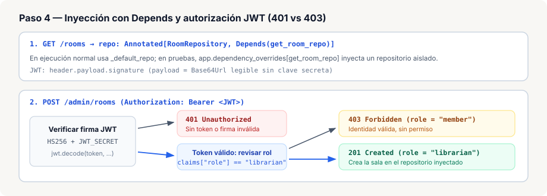

# Paso 4. Inyección con `Depends` y autorización con JWT



## Por qué importa

Una API fácil de mantener no lee variables globales dentro de sus rutas: declara sus dependencias con [FastAPI `Depends`](https://fastapi.tiangolo.com/tutorial/dependencies/) para poder sustituirlas en pruebas con [`dependency_overrides`](https://fastapi.tiangolo.com/advanced/testing-dependencies/). Al mismo tiempo, entender que el bloque central de un [JWT (RFC 7519)](https://datatracker.ietf.org/doc/html/rfc7519) viene codificado en [`Base64Url`](https://docs.python.org/3/library/base64.html#base64.urlsafe_b64decode) —y no cifrado— evita guardar secretos dentro del token, mientras separar [`401 Unauthorized`](https://developer.mozilla.org/en-US/docs/Web/HTTP/Status/401) de [`403 Forbidden`](https://developer.mozilla.org/en-US/docs/Web/HTTP/Status/403) deja claro si falló la identidad o si faltaron permisos.

## Qué se construye

Trabajas sobre [paso04_depends_y_jwt.py](../../paso04_depends_y_jwt.py) (~12 minutos):

- **Inyección de dependencias en `GET /rooms` (TODO 1):** recibe `repo: Annotated[RoomRepository, Depends(get_room_repo)]` y retorna `repo.list_rooms()` en lugar de leer `_default_repo` directo.
- **Decodificación Base64Url en `decode_jwt_payload_unverified` (TODO 2):** separa `token.split(".")`, toma `parts[1]`, agrega el relleno `=` faltante (`"=" * (-len(payload_segment) % 4)`), decodifica con `base64.urlsafe_b64decode(...)` y convierte el JSON con `json.loads(...)`.
- **Separación de `401` y `403` en `POST /admin/rooms` (TODO 3):** mantiene `401 Unauthorized` si falta el token o falla la firma, y cambia a `status.HTTP_403_FORBIDDEN` cuando el token es válido pero `claims.get("role") != "librarian"`.

## Criterios de aceptación

- `CA-4.1` Sobrescribir `app.dependency_overrides[get_room_repo]` hace que `GET /rooms` devuelva las salas del repositorio inyectado.
- `CA-4.2` `decode_jwt_payload_unverified(token)` devuelve el diccionario con `sub` y `role` sin usar `JWT_SECRET`.
- `CA-4.3` `POST /admin/rooms` responde `401` sin token o con firma inválida, `403` con un token válido de rol `"member"`, y `201` con un token válido de rol `"librarian"`.

## Cómo verificar

Observa en vivo el resultado de los tokens y corre las pruebas del Paso 4:

```bash
uv run onramp inspect --paso 4
uv run onramp check --paso 4
```
