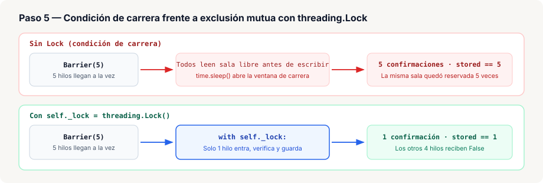

# Paso 5. Concurrencia y exclusión mutua con `threading.Lock`



## Por qué importa

Cuando dos o más peticiones llegan al mismo tiempo y consultan un recurso compartido antes de actualizarlo, aparece una condición de carrera: ambos hilos ven el cupo libre y ambos confirman la operación. Proteger esa sección crítica con [`threading.Lock`](https://docs.python.org/3/library/threading.html#lock-objects) asegura que solo un hilo a la vez verifique disponibilidad y escriba la reserva.

## Qué se construye

Trabajas sobre [paso05_concurrencia.py](../../paso05_concurrencia.py) (~8 minutos):

- **Candado de exclusión mutua en `RoomReservationService` (TODO 1):** crea `self._lock = threading.Lock()` en `__init__` y envuelve el cuerpo de `reserve` y `reservation_count` dentro de `with self._lock:`.

## Criterios de aceptación

- `CA-5.1` Ante 5 hilos sincronizados con `Barrier(5)` intentando reservar `"sala-a"`, `RoomReservationService` confirma exactamente 1 reserva (`successes == 1`) y guarda exactamente 1 registro (`stored == 1`).
- `CA-5.2` Reservar salas distintas (`"sala-a"` y `"sala-b"`) bajo contención de 5 hilos por sala mantiene exactamente 1 reserva confirmada y 1 registro en cada sala.

## Cómo verificar

Observa la simulación con `Barrier(5)` y corre las pruebas del Paso 5:

```bash
uv run onramp inspect --paso 5
uv run onramp check --paso 5
```
